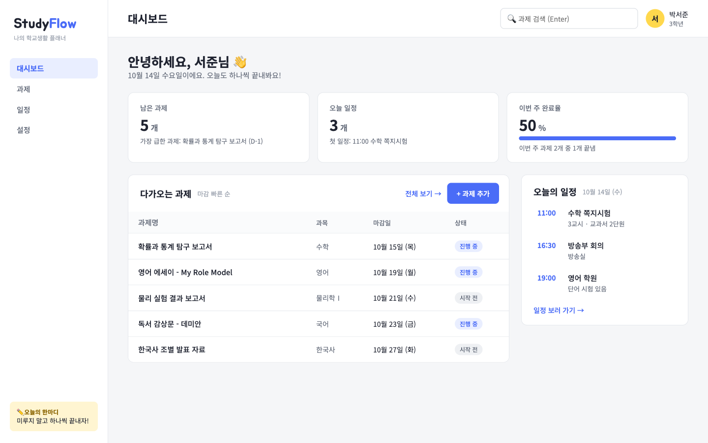
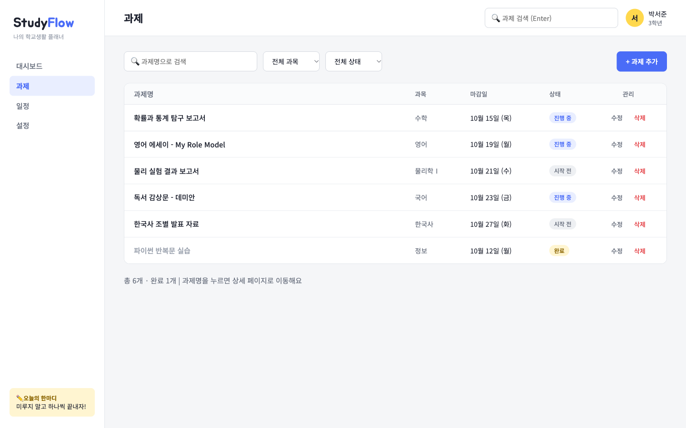
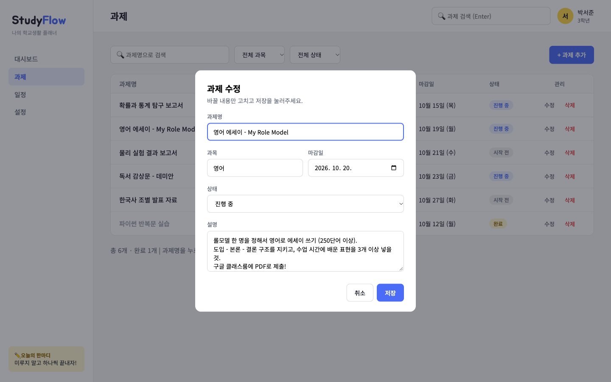
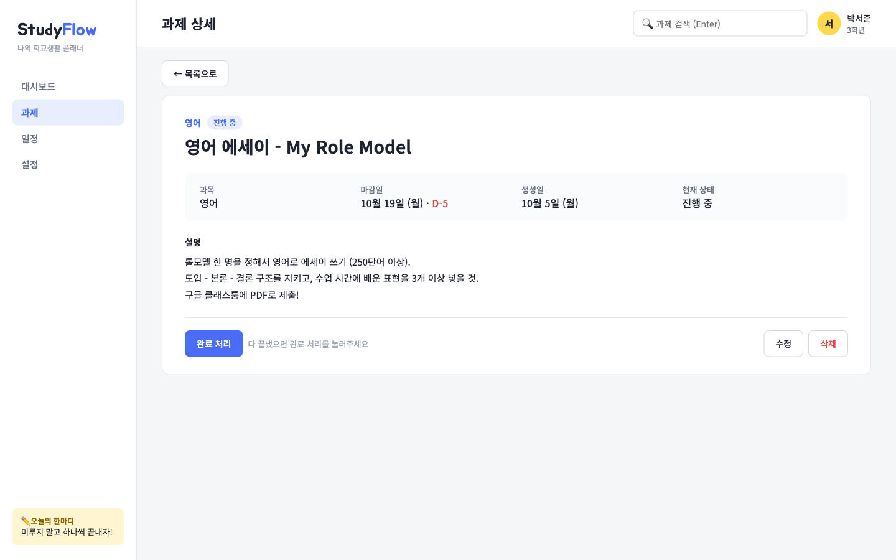
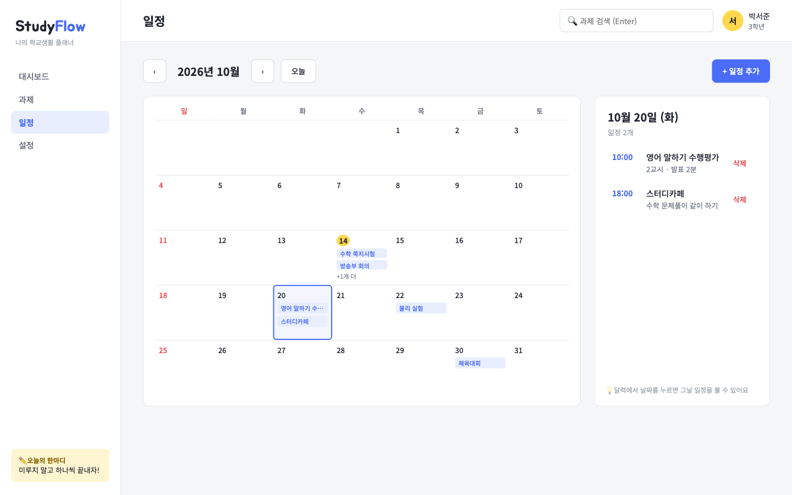

# StudyFlow — 나의 학교생활 플래너

학교 과제와 일정을 한 곳에서 관리할 수 있는 웹페이지입니다.
Figma로 설계한 UI 프로토타입을 HTML · CSS · JavaScript로 직접 구현했습니다.

🔗 **바로 보기:** https://swjun08.github.io/studyflow/

## 만든 이유

과제 마감일은 구글 클래스룸에, 수행평가 날짜는 학교 공지에, 학원 일정은 휴대폰 캘린더에 흩어져 있어서
"이번 주에 뭘 해야 하지?"를 한눈에 보기 어려웠습니다.
그래서 **과제 + 일정을 한 화면에서 보고, 바로 추가·수정·삭제할 수 있는** 페이지를 만들었습니다.

## 화면

| 대시보드 | 과제 목록 |
|---|---|
|  |  |
| **과제 수정 모달** | **과제 상세** |
|  |  |
| **일정 (달력)** | |
|  | |

## 페이지 구성

| 페이지 | 파일 | 내용 |
|---|---|---|
| 대시보드 | `index.html` | 남은 과제 수, 오늘 일정 수, 이번 주 완료율, 다가오는 과제, 오늘의 일정 |
| 과제 | `tasks.html` | 과제 목록, 검색, 과목/상태 필터, 과제 추가·수정·삭제 |
| 과제 상세 | `detail.html` | 과제 정보, 마감 D-day, 완료 처리, 수정·삭제 |
| 일정 | `calendar.html` | 월간 달력, 날짜 클릭 시 그날 일정 보기, 일정 추가·삭제 |

## 기능 (CRUD)

| | 과제 | 일정 |
|---|---|---|
| **C**reate | `+ 과제 추가` → 모달에 입력 → 추가 | `+ 일정 추가` → 모달에 입력 → 저장 |
| **R**ead | 과제 목록, 검색/필터, 상세 페이지 | 달력 표시, 날짜별 일정 목록 |
| **U**pdate | 목록·상세의 `수정`, 상세의 `완료 처리` | — |
| **D**elete | 목록·상세의 `삭제` → 삭제 확인 모달 | 날짜별 목록의 `삭제` |

데이터는 브라우저의 **localStorage**에 JSON으로 저장되기 때문에 새로고침하거나 다른 페이지로 이동해도 유지됩니다.
처음 접속하면 예시 과제와 일정이 자동으로 들어갑니다. (처음 상태로 돌리려면 개발자 도구 → Application → Local Storage에서 삭제)

## 사용 기술

- HTML5 (`<dialog>` 모달, `<input type="date">` 등 기본 태그 사용)
- CSS3 (Flexbox, Grid, CSS 변수)
- JavaScript (라이브러리 없이 순수 JS)
- 폰트: Noto Sans KR, Jua (Google Fonts)
- 배포: GitHub Pages

## 폴더 구조

```
studyflow/
├── index.html       대시보드
├── tasks.html       과제 목록
├── detail.html      과제 상세
├── calendar.html    일정(달력)
├── css/
│   └── style.css    전체 스타일
└── js/
    ├── data.js      데이터 저장/불러오기 (CRUD 함수)
    ├── common.js    날짜 표시, 알림, 모달 등 공통 함수
    ├── dashboard.js 대시보드
    ├── tasks.js     과제 목록
    ├── detail.js    과제 상세
    └── calendar.js  달력
```

## 실행 방법

1. 위의 GitHub Pages 주소로 접속하거나
2. 저장소를 내려받아 `index.html`을 브라우저로 열면 됩니다. (설치 필요 없음)

---
서울인공지능고등학교 AI컴퓨터과 30104 박서준 · 응용프로그래밍 화면 구현
